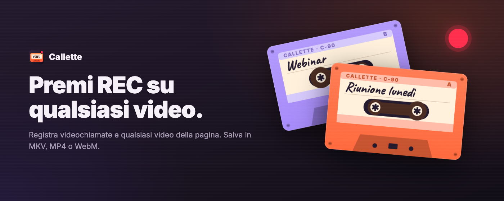
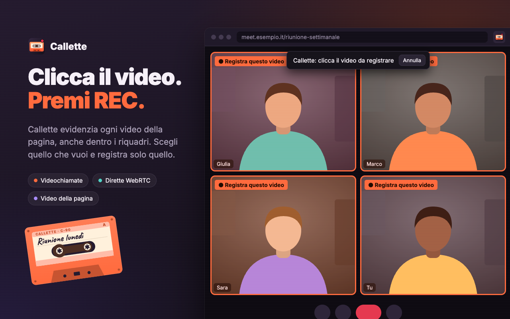
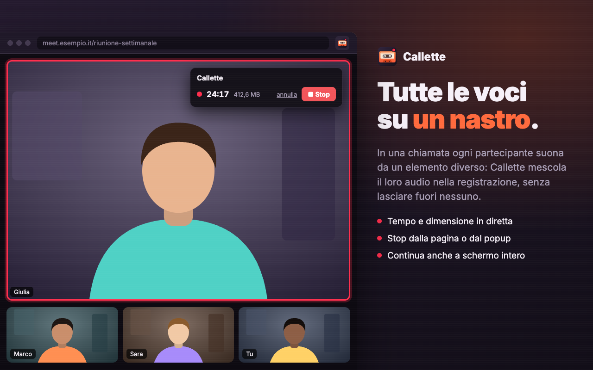
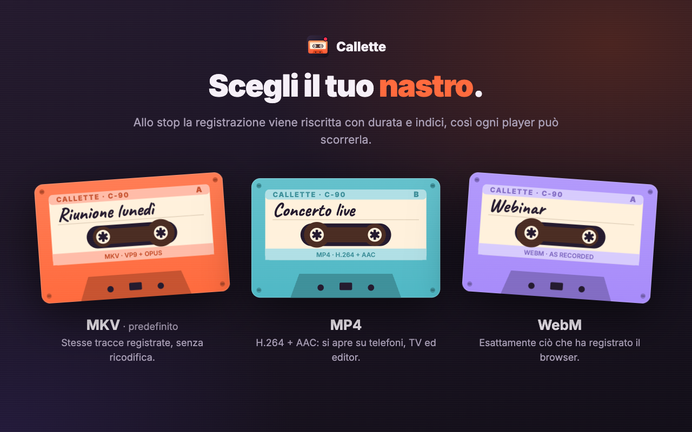
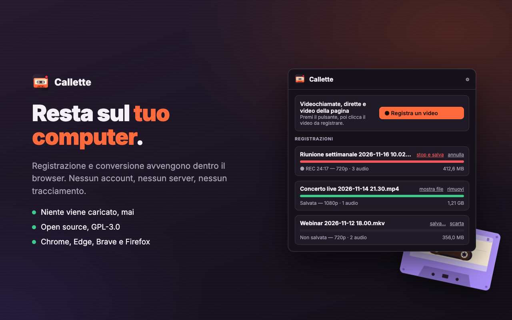

# Callette

> Premi REC su qualsiasi video.

*[English](README.md)*

Estensione per browser Chromium e Firefox che registra il video che scegli in una pagina web — **videochiamate**,
**dirette WebRTC**, webinar, player — e lo salva in **MKV, MP4 o WebM**. Tutto avviene dentro il browser: niente da
installare, nulla viene caricato. Interfaccia in inglese e italiano (segue la lingua del browser).

<table>
<tr>
<td width="50%"> Clicca il video, premi REC</td>
<td width="50%"> Tutte le voci della chiamata su un nastro</td>
</tr>
<tr>
<td width="50%"> MKV, MP4 o WebM</td>
<td width="50%"> Le registrazioni restano sul tuo computer</td>
</tr>
</table>

## Come si registra

1. Nel popup premi **● Registra un video**: i video della pagina (anche dentro i riquadri) vengono evidenziati.
2. Clicca quello da registrare: compare un pannello in alto a destra. Se l'audio è riprodotto da altri elementi
   della pagina (tipico delle videochiamate, uno per partecipante), *Aggiungi l'audio degli altri elementi* li
   mescola nella registrazione.
3. **● Registra**, poi **■ Stop** (dal pannello o da *stop e salva* nel popup): si apre "Salva con nome" per
   scegliere dove salvare il file. Se chiudi la finestra senza salvare, la registrazione resta nel popup con
   *salva…* / *scarta*.

## Formati (⚙)

| | Come viene prodotto |
|---|---|
| **MKV** (predefinito) | il WebM registrato (VP9/VP8 + Opus) copiato in MKV, senza ricodifica |
| **MP4** | Chromium registra direttamente in H.264 → solo copia (Opus convertito in AAC se il browser lo sa codificare); Firefox registra solo VP8 → allo stop ricodifica in H.264 + AAC con WebCodecs |
| conversione disattivata | il `.webm` registrato dal browser |

Se la conversione non riesce, il file viene salvato così come è stato registrato e il popup lo segnala.

Come funziona: `MediaRecorder` registra lo stream del `<video>` (`srcObject`, oppure `captureStream()` per i video
normali su Chromium) in pezzi da 1 s che finiscono nello spazio privato dell'estensione (OPFS). Allo stop il file
viene riscritto con la `Conversion` di Mediabunny, che aggiunge anche durata e indici: senza, molti player non
permettono di spostarsi nel file. Se la scheda viene chiusa durante la registrazione, quanto registrato fino a quel
momento viene comunque proposto per il salvataggio.

## Versioni GitHub e store

| | Release GitHub (`chromium`, `firefox`) | Store (`chrome-store`, `firefox-store`) |
|---|---|---|
| YouTube | sì | no: le pagine di YouTube vengono rifiutate (policy del Chrome Web Store) |
| ID Chromium | fisso grazie alla `key` del manifest (`lmpmoaldkcidlimaggkfpinmjpedipjg`) | assegnato dallo store |

La differenza è un solo file generato, `build-flags.js` (`STORE_BUILD`, `DONATE_URL`).

## Build, release, store

Vedi il [README inglese](README.md): `./build.py` genera i quattro pacchetti in `dist/`; a ogni push su `main` il
workflow pubblica la release `vX.Y.Z` se la versione del manifest è nuova; testi e immagini degli store sono in
`docs/store/` (`listing.md`, `images/{en,it}/`), l'informativa privacy in `docs/PRIVACY.md`. I testi dell'interfaccia
si modificano in `tools/messages.py`.

## Installazione

- **Chromium/Brave/Chrome/Edge**: `chrome://extensions` → *Modalità sviluppatore* → *Carica estensione non
  pacchettizzata* → `dist/chromium/` (oppure `extension/`).
- **Firefox**: `about:debugging#/runtime/this-firefox` → *Carica componente aggiuntivo temporaneo* →
  `dist/firefox/manifest.json`. Per un'installazione permanente l'`.xpi` va firmato da Mozilla (vedi Release).

## Limiti noti

- La registrazione **ricodifica**: un video WebRTC arriva già decodificato, non ci sono pacchetti originali da copiare.
- Le tracce audio aggiunte dopo l'avvio (nuovi partecipanti) e i cambi di `srcObject` durante la registrazione non
  vengono seguiti.
- Su Firefox si registrano solo i video WebRTC (`srcObject`): `mozCaptureStream` toglierebbe l'audio alla pagina.
- I player protetti da DRM (Widevine/PlayReady/FairPlay) non espongono il loro flusso e non si possono registrare.

## Licenza

Callette è software libero: [GNU GPL v3.0 o successiva](LICENSE), con i [termini aggiuntivi](ADDITIONAL-TERMS.md)
consentiti dalla sezione 7: vanno mantenute le attribuzioni *"Callette by lnx85"* e *"Based on Fluxy by
lorisilbagnino"* (nel codice e in fondo alle impostazioni), le versioni modificate non possono chiamarsi "Callette" e
la licenza non concede diritti su nome e logo.

Callette è una versione modificata di [Fluxy](https://github.com/lorisilbagnino/fluxy) di lorisilbagnino: ne
mantiene il registratore video e toglie il download degli stream HLS/DASH. Mediabunny
(`extension/engine/mediabunny.min.mjs`) mantiene la sua licenza, MPL-2.0.

## Sostieni il progetto

Callette è gratuito. Se ti è utile puoi sostenerlo con una donazione spontanea:
[**ko-fi.com/lnx85**](https://ko-fi.com/lnx85) ☕
