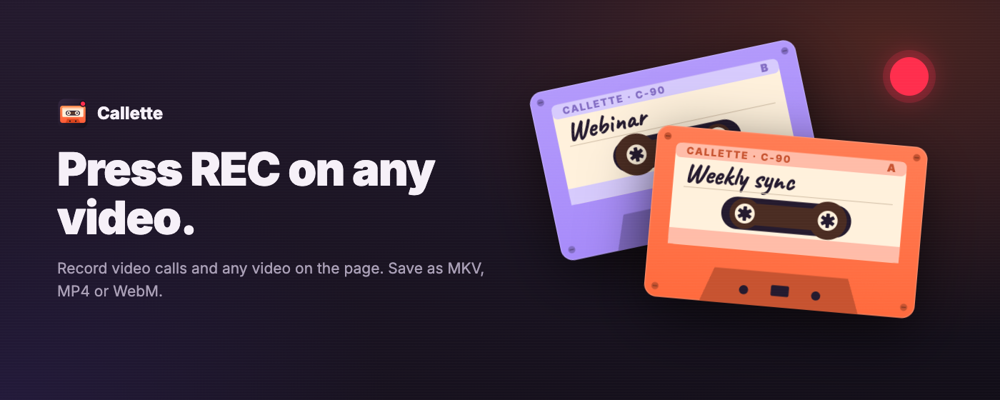
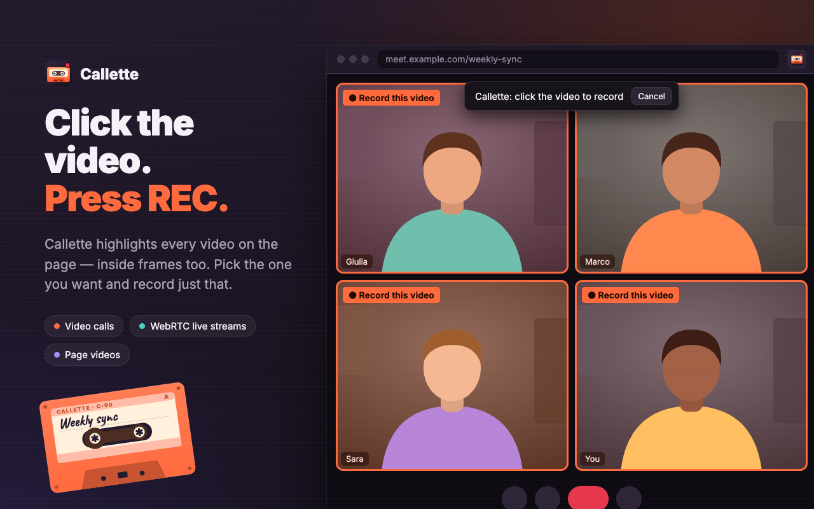
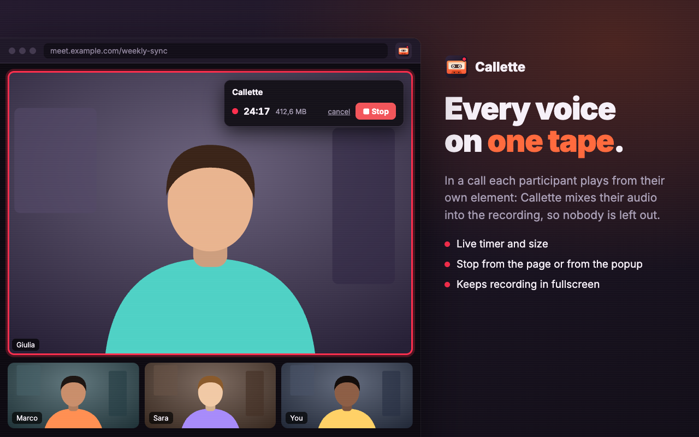
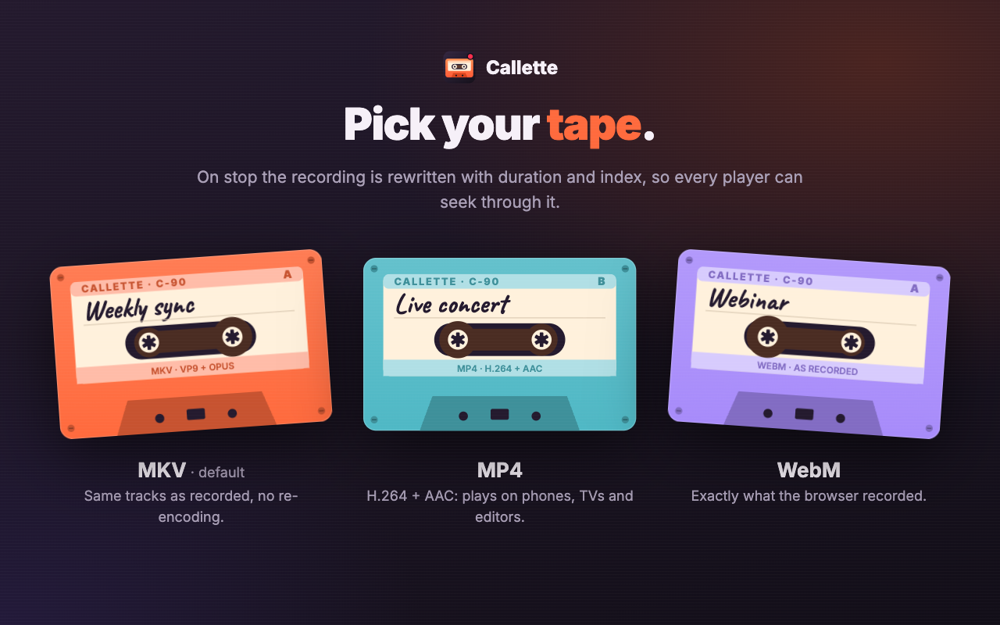
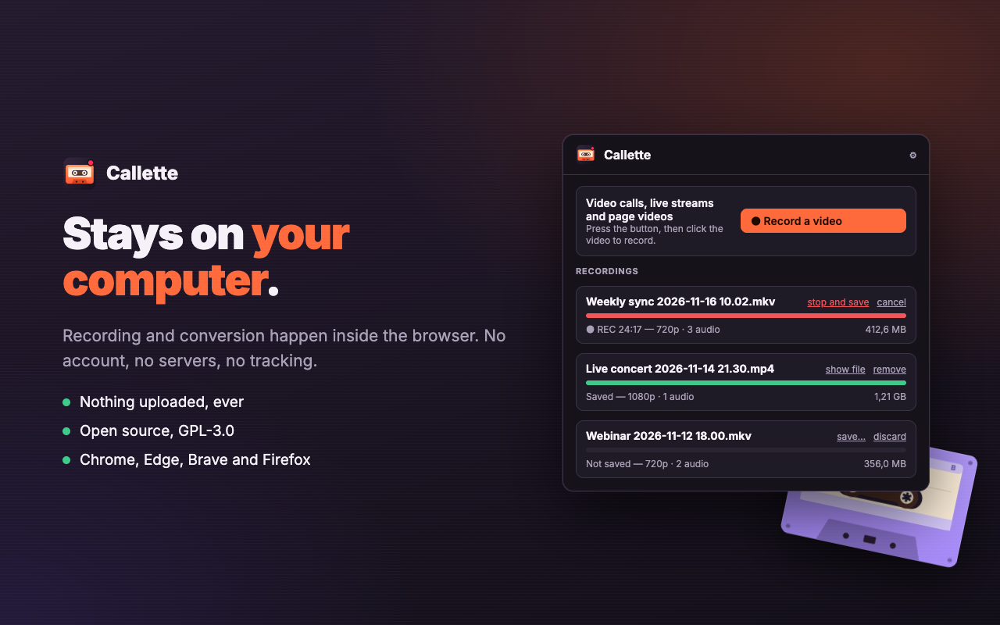

# Callette

> Press REC on any video.

*[Italiano](README.it.md)*

Browser extension for Chromium and Firefox that records the video you pick on a web page — **video calls**,
**WebRTC live streams**, webinars, players — and saves it as **MKV, MP4 or WebM**. Everything happens inside the
browser: nothing to install, nothing uploaded. Interface in English and Italian (it follows the browser's language).

<p align="center"></p>

<table>
<tr>
<td width="50%"><br><sub>Click the video, press REC</sub></td>
<td width="50%"><br><sub>Every voice of the call on one tape</sub></td>
</tr>
<tr>
<td width="50%"><br><sub>MKV, MP4 or WebM</sub></td>
<td width="50%"><br><sub>Recordings stay on your computer</sub></td>
</tr>
</table>

## How to record

1. In the popup press **● Record a video**: the page's videos (inside frames too) are highlighted.
2. Click the one to record: a panel appears at the top right. If the audio is played by other elements of the page
   (typical of video calls, one per participant), *Add the audio of the page's other elements* mixes them into the
   recording.
3. **● Record**, then **■ Stop** (from the panel or *stop and save* in the popup): the "Save as" dialog lets you
   choose where to save the file. If you close it without saving, the recording stays in the popup with *save…* /
   *discard*.

## Formats (⚙)

| | How it's produced |
|---|---|
| **MKV** (default) | the recorded WebM (VP9/VP8 + Opus) copied into MKV, no re-encoding |
| **MP4** | Chromium records straight in H.264 → copy only (Opus converted to AAC if the browser can encode it); Firefox only records VP8 → re-encoded to H.264 + AAC with WebCodecs on stop |
| conversion off | the `.webm` recorded by the browser |

If the conversion fails, the file is saved as recorded and the popup says so.

How it works: `MediaRecorder` records the `<video>`'s stream (`srcObject`, or `captureStream()` for regular videos
on Chromium) in 1 s chunks that go to the extension's private storage (OPFS). On stop the file is rewritten with
Mediabunny's `Conversion`, which also adds duration and cues: without them many players can't seek. If the tab is
closed while recording, what was recorded so far is still offered for saving.

## GitHub builds and store builds

| | GitHub release (`chromium`, `firefox`) | Stores (`chrome-store`, `firefox-store`) |
|---|---|---|
| YouTube | yes | no: YouTube pages are refused (Chrome Web Store policy) |
| Chromium ID | fixed through the manifest `key` (`lmpmoaldkcidlimaggkfpinmjpedipjg`) | assigned by the store |

The difference is a single generated file, `build-flags.js` (`STORE_BUILD`, `DONATE_URL`).

## Architecture

```
extension/
  background.js   injects the picker on request, keeps the list of recordings, saves through the downloads API
  recorder/
    page.js         runs in the page (MAIN world): video picker, panel, MediaRecorder
    bridge.js       content script: creates the job and streams the chunks to the engine over a port
  engine/
    runner.js       receives a recording into OPFS, converts it, hands back a file to save; OPFS cleanup
    engine.js       conversion with Mediabunny (MPL-2.0, vendored), WebCodecs when re-encoding is needed
    i18n.js         strings for the contexts without chrome.i18n (offscreen document, page)
  offscreen.*     Chromium: hidden document running runner.js (the service worker may be stopped)
                  Firefox: runner.js runs in the background page, kept awake while recording
  popup.*         record button, list of recordings, settings
  _locales/       en, it (generated from tools/messages.py)
tools/messages.py UI strings (English + Italian)
```

## Languages

Texts live in `tools/messages.py` (one entry per key: English, Italian); the build writes
`extension/_locales/{en,it}/messages.json` and `extension/engine/i18n-keys.js`. The browser picks the language of its
own UI and falls back to English. To add a language: add a column to the table and a locale to `write()`.

## Build

```bash
./build.py                              # DONATE_URL= ./build.py  builds without the Ko-fi link
```

| Target | Unpacked | Archive |
|---|---|---|
| Brave, Chrome, Chromium, Edge, Vivaldi… | `dist/chromium/` | `callette-<ver>-chromium.zip` |
| Firefox, LibreWolf, Waterfox | `dist/firefox/` | `callette-<ver>-firefox.xpi` |
| Chrome Web Store, Edge Add-ons | `dist/chrome-store/` | `callette-<ver>-chrome-store.zip` |
| addons.mozilla.org | `dist/firefox-store/` | `callette-<ver>-firefox-store.xpi` |

`extension/` is the source (Chromium manifest) and can be loaded directly. For Firefox only the manifest changes:
background as an *event page*, no `offscreen` and `key`, ID `callette@callette.addon`.

## Releases

On every push to `main`, `.github/workflows/release.yml` reads `version` from `extension/manifest.json`: if release
`vX.Y.Z` doesn't exist yet, it runs `build.py` and publishes it with the packages and the install instructions from
`docs/release-notes.md`. Bump the version to publish a new release; it can also be started by hand from
*Actions → Build e release*.

- Firefox only installs Mozilla-signed packages permanently: with the repository secrets `AMO_JWT_ISSUER` and
  `AMO_JWT_SECRET` (addons.mozilla.org API keys) the workflow signs the `.xpi` as an *unlisted* add-on.
- Chromium doesn't install `.crx` files from outside the Web Store: load the zip in developer mode.
- The repository variable `DONATE_URL` overrides the Ko-fi link used by the release builds.

## Stores

Listing texts (EN/IT), permission justifications, reviewer notes and checklist: `docs/store/listing.md`.
Privacy policy: `docs/PRIVACY.md`. Images (1280×800 screenshots, promo tiles and the GitHub social preview, English
and Italian) in `docs/store/images/{en,it}/`, rendered from the HTML sources in `docs/store/src/` with
`node docs/store/render.mjs` (the extension icons: `node docs/store/render.mjs icons`).

## Installation

- **Chromium/Brave/Chrome/Edge**: `chrome://extensions` → *Developer mode* → *Load unpacked* → `dist/chromium/` (or
  `extension/`). The ID is fixed (`lmpmoaldkcidlimaggkfpinmjpedipjg`) by the manifest `key`.
- **Firefox**: `about:debugging#/runtime/this-firefox` → *Load Temporary Add-on* → `dist/firefox/manifest.json`. It
  stays loaded until Firefox closes: for a permanent install the `.xpi` must be signed by Mozilla (see Releases), or
  use Firefox Developer Edition/Nightly with `xpinstall.signatures.required = false`.

## Debug

- Popup as a normal page: `chrome-extension://lmpmoaldkcidlimaggkfpinmjpedipjg/popup.html?tab=<tabId>`
- Service worker console: `chrome://extensions` → Callette → *service worker*; recording engine: *offscreen.html* on
  the same page. Firefox: `about:debugging` → *Inspect*.

## Known limits

- Recording **re-encodes**: a WebRTC video arrives already decoded, there are no original packets to copy.
- Audio tracks added after the start (new participants) and `srcObject` changes during the recording are not
  followed.
- On Firefox only WebRTC videos (`srcObject`) can be recorded: `mozCaptureStream` would mute the page.
- DRM-protected players (Widevine/PlayReady/FairPlay) don't expose their stream and can't be recorded.

## License

Callette is free software: [GNU GPL v3.0 or later](LICENSE), with the [additional terms](ADDITIONAL-TERMS.md) allowed
by section 7:

- keep the attributions *"Callette by lnx85"* and *"Based on Fluxy by lorisilbagnino"* in the code and in the lines
  at the bottom of the settings panel;
- modified versions can't be called "Callette" and must say they are a modified version;
- the license grants no rights to the Callette name and logo.

Callette is a modified version of [Fluxy](https://github.com/lorisilbagnino/fluxy) by lorisilbagnino: it keeps its
video recorder and drops the HLS/DASH downloader. Mediabunny (`extension/engine/mediabunny.min.mjs`) keeps its own
license, MPL-2.0. Contributions sent as pull requests are accepted under the same license.

## Support

Callette is free. If it's useful to you, you can support it with a spontaneous donation:
[**ko-fi.com/lnx85**](https://ko-fi.com/lnx85) ☕ (also linked in the settings panel and on the store pages).
